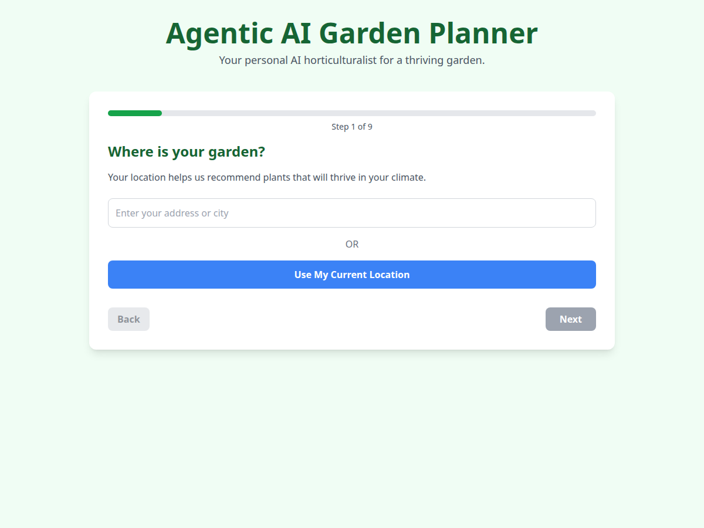
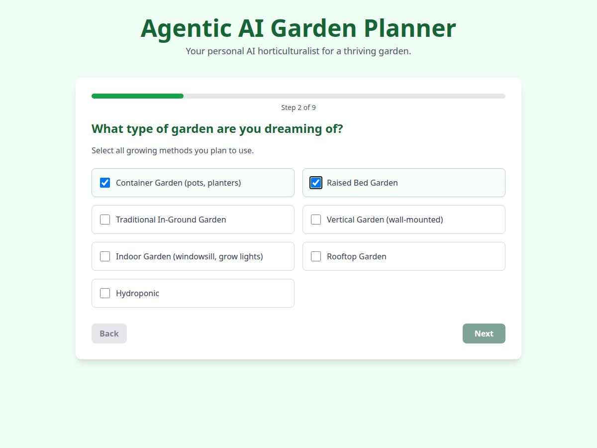
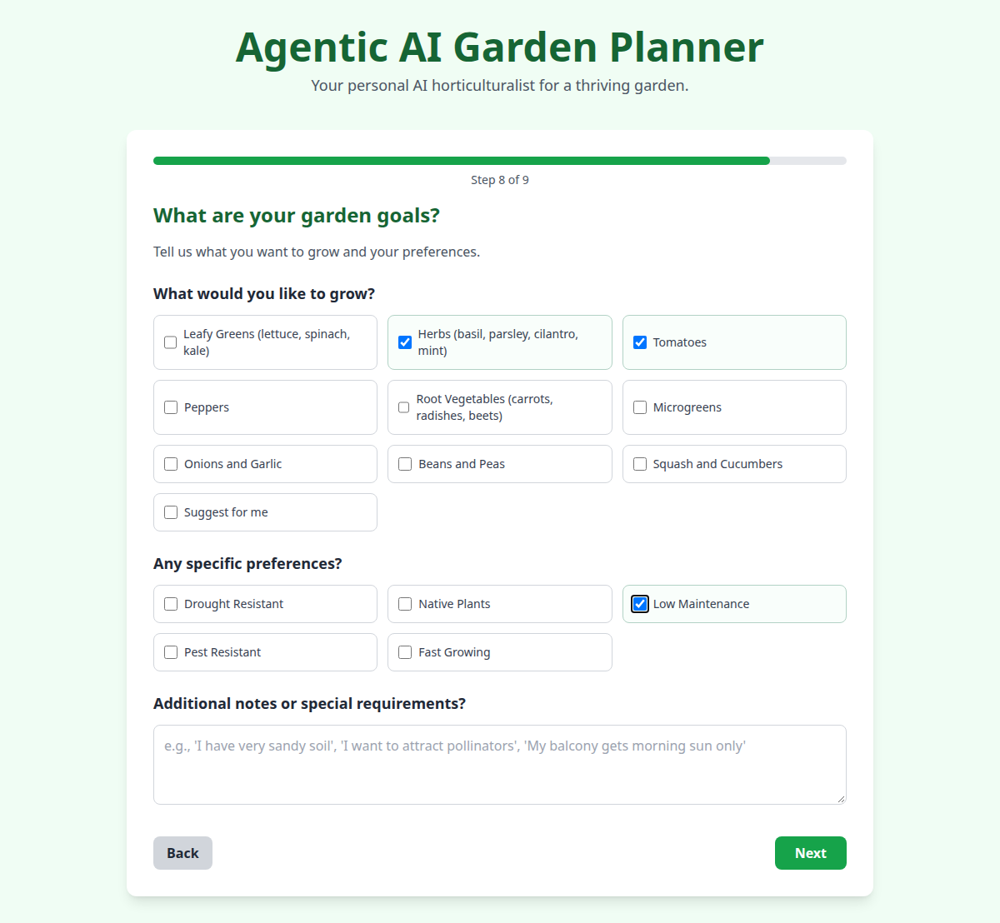
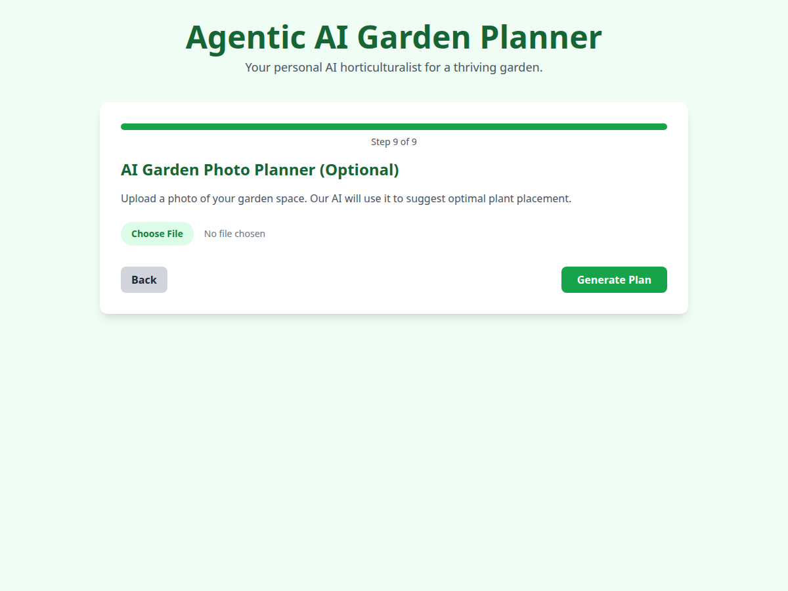

# Agentic AI Garden Planner

This is Shay Bouchles’s public portfolio experiment: a [Google AI Studio](https://ai.studio/apps/drive/1gxHwCuwFzAodC_h1s768oibl1HZzWDvm) prototype of **Ask Jane**, the AI garden planner for Saved by the Plate, a food-justice education nonprofit.

It is a browser wizard. The visitor describes a garden, and the page asks Gemini for crop ideas, a layout, a planting schedule, and links that came back with the model’s Google Search results. After a plan loads, the same page can send a plant photo to Gemini and show a possible disease, a description, and a suggested treatment.

The UI title is “Agentic AI Garden Planner.” The npm package name, `copy-of-agentic-ai-garden-planner`, is the name from the AI Studio export. This repository is not a deployed site. The main garden planner is [shaythegay13/agenticaigardenplanner](https://github.com/shaythegay13/agenticaigardenplanner), a separate Python project.

Screenshots below are from a local `npm run dev` session on 14 October 2026. Plan generation needs a Gemini API key, so these images show the wizard only.

## What it does

The wizard is nine steps. Next stays disabled until the step has an answer, except where noted.

1. **Location.** A city or address, or the browser’s geolocation. A successful geolocation read stores latitude and longitude and shows them on the page. The map area is a placeholder that says the preview is unavailable. Typing an address clears any earlier coordinates.
2. **Garden type.** One or more of: container, raised bed, in-ground, vertical, indoor, rooftop, hydroponic.
3. **Space.** Small, medium, large, or very large.
4. **Setting.** Indoor, outdoor, or both. The form starts on outdoor, so Next is available immediately.
5. **Seasons.** Any of spring, summer, fall, and winter, with the month ranges shown in the form.
6. **Time.** Minimal (weekly), moderate (a few times a week), or dedicated (daily).
7. **Experience.** Beginner, novice, intermediate, or advanced.
8. **Goals.** Crops and preferences from the lists in `constants.ts`, plus a free-text note. Next stays disabled until at least one crop is checked, or the note contains the word “suggest.” “Suggest for me” is one of the crop choices.
9. **Photo.** Optional. An uploaded image is sent with the planning request. The prompt tells the model to refer to it in the layout.

**Generate Plan** calls `gemini-2.5-pro` through `@google/genai`, with Google Search enabled and a thinking budget of 32768. The prompt asks for one JSON object with:

- `cropRecommendations`: the prompt asks for 16–20 crops across vegetables, fruits, herbs, legumes, and grains. Each item has a name, type, season, time to maturity, expected output, sunlight, water needs, and a short benefit.
- `gardenLayout`: text the prompt asks to write as Markdown, including companion planting.
- `plantingSchedule`: text the prompt asks to write as a Markdown table.

The page groups crops by the `type` string and shows the name, benefit, season, maturity, sun, and water. Expected output is part of the requested JSON and is not rendered. Layout and schedule are shown as the model’s text with line breaks preserved. They are not passed through a Markdown renderer.

Educational links are taken from the response’s grounding chunks, not from the JSON. A YouTube or Vimeo URL is labeled Video. A title that contains “course” is labeled Course. Everything else is labeled Article. If the response has no grounding chunks, that section is empty.

The plan page then shows **Plant Disease Identifier**. A photo is sent to `gemini-2.5-flash`, which is asked for JSON with `disease`, `description`, and `treatment`, including organic treatment options. That tool is on the plan page, so it appears after a plan has been generated.

Choosing **Start a New Plan** clears the form and the plan. Nothing is saved to an account or a database. The page has no backend of its own.

## Screenshots

Location, the first step:



Garden type, with more than one method selected:



Goals, including crop choices, preferences, and notes:



Optional photo, the last step before generation:



## Stack

- [React](https://react.dev/) 19 and React DOM
- [Vite](https://vite.dev/) 6
- TypeScript 5.8
- [Tailwind CSS](https://tailwindcss.com/), loaded from the CDN in `index.html` rather than compiled by the build
- [`@google/genai`](https://www.npmjs.com/package/@google/genai) for Gemini
- Browser geolocation (`metadata.json` also requests that permission for the AI Studio frame)

`GEMINI_API_KEY` is read at dev-server and build time and written into the JavaScript the browser runs. The page then calls Gemini directly from the visitor’s browser.

## Setup

Checked with Node.js 22.14.0 and npm 10.9.9.

```bash
npm install
cp .env.example .env.local
```

Edit `.env.local` and set `GEMINI_API_KEY` to a [Gemini API key](https://aistudio.google.com/apikey). `.env` works as well. Both files are gitignored. `.env.example` lists the name only.

```bash
npm run dev
```

Open [http://localhost:3000](http://localhost:3000).

```bash
npm run build
npm run preview
```

Without a key, the wizard still runs. **Generate Plan** stays on the photo step and shows “Sorry, we couldn't generate your garden plan. Please try again.” The same is true for the disease check, which shows “Failed to identify disease. Please try again.”

The key is visible to anyone who can load the built page. Use a key that is acceptable for a local demo, and do not commit a file that contains it.

## Layout

| Path | Role |
| --- | --- |
| `App.tsx` | Wizard, plan view, and reset |
| `constants.ts` | Step order and the option lists |
| `types.ts` | Form, plan, crop, and disease types |
| `services/geminiService.ts` | Plan generation and disease identification |
| `components/DiseaseIdentifier.tsx` | Photo upload for the disease check |
| `components/shared/` | Card and spinner |
| `vite.config.ts` | Dev server, path alias, and API key injection |
| `metadata.json` | AI Studio name, description, and geolocation permission |

## Contributors

Git history for this repository has one author:

- [Shay Bouchles](https://github.com/shaythegay13) — both commits (`Initial commit` and `feat: Initialize project structure and dependencies`)

## Limits worth knowing

- Crop section headings add the letter “s” to whatever type string the model returns.
- Layout and schedule text are inserted as HTML line breaks, so a Markdown table stays a text table.
- `/vite.svg` is linked from `index.html` and is not in the repo. The dev server answers that request with the HTML page.
- Tailwind’s CDN script logs a warning that the CDN build is not meant for production.
- The production bundle includes the Gemini client. A local production build of this tree was about 306 kB of JavaScript (94 kB gzipped).
